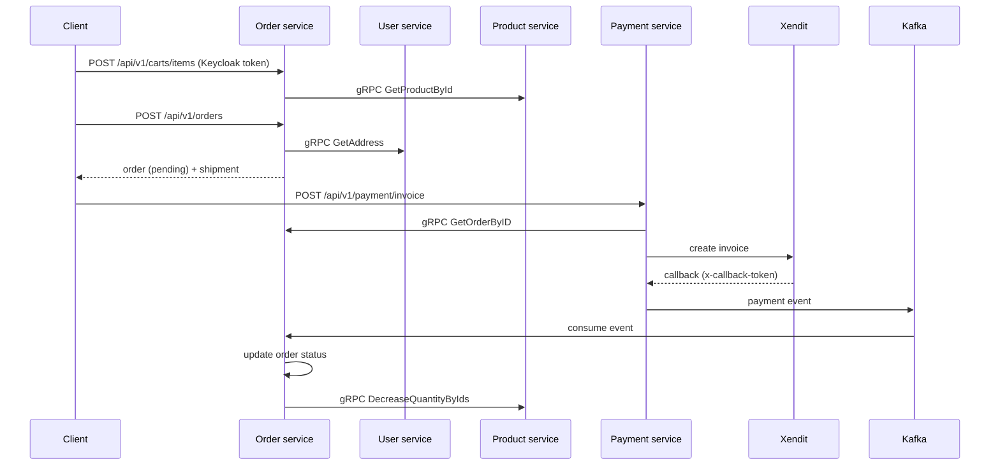

# Golectro

An e-commerce backend built as **four Go microservices** that talk over **REST, gRPC, and Kafka**, with Keycloak for
sign-in, HashiCorp Vault for encrypting customer addresses, Elasticsearch for product search, MinIO for images, and
Xendit for payments.

## Services

| Service | Responsibility | REST | gRPC |
|---|---|---|---|
| [user-service](https://github.com/golectro/user-service) | Users, addresses (envelope encryption with Vault Transit), avatars | :8080 | :50051 |
| [product-service](https://github.com/golectro/product-service) | Catalog, Elasticsearch search, MinIO images, stock | :8081 | :50052 |
| [payment-service](https://github.com/golectro/payment-service) | Xendit invoices and callbacks | :8082 | — |
| [order-service](https://github.com/golectro/order-service) | Carts, orders, shipments | :8083 | :50054 |

## Checkout flow

## Shared design
- Clean Architecture in every service: `delivery` (HTTP, gRPC, Kafka) → `usecase` → `repository` → `entity`.
- Authentication: Keycloak access tokens, verified in each service against the realm's JWKS.
- Each service has its own MySQL database; Redis for rate limiting; MongoDB for request logs.
- CI on GitHub Actions: `gofmt`, `go build`, `go vet`, `go test -race`.

## Status
Personal project (Aug 2025). The four services above are the working system. Planned but not built: a notification
service, a shared proto repo, infrastructure as code, and the web/admin frontends (those repos are archived).
